# Records Management Tracker

A working records management system built in **SharePoint** and **Power Automate** to track student records requests (transcripts, subpoenas, enrollment verifications, records transfers), communications, equipment, and system changes.

> **All data in this project is fictional.** No real student information is used, in keeping with FERPA.

**Demo video:** [Watch the walkthrough on Loom](LOOM_LINK_HERE)
**Portfolio site:** [View the live portfolio](https://github.com/marissam8/records-management-tracker)

## What it does

- **Tracks every request** from intake to completion, with status, due date, requester and release-form status.
- **Assigns IDs and due dates automatically** when a request comes in (for example, `TR-0153`, due in 7 days for transcripts).
- **Blocks release without consent** by moving any request with no signed release to *Pending release*.
- **Routes subpoenas to Legal** for approval before any records are produced.
- **Emails a daily overdue report** so late items are caught the morning they slip.
- **Stamps completion dates** for turnaround reporting.
- **Logs communications** with schools, central office, parents and outside agencies, plus equipment deployment.
- **Documents every system change** in a change log backed by SharePoint version history.

## How it fits together

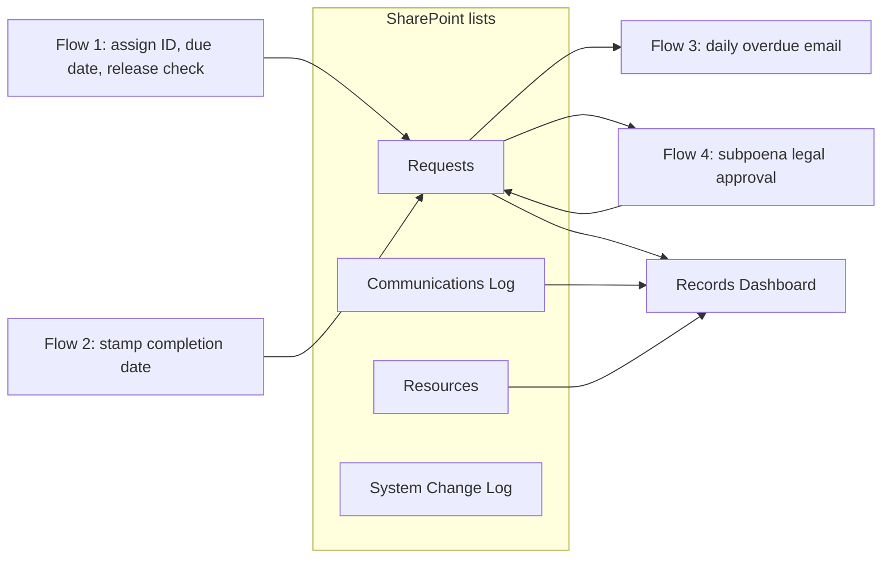

## Subpoena workflow

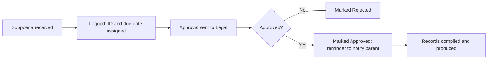

## Built with

| Tool | Used for |
| --- | --- |
| SharePoint Online lists | Data storage, views, status board, row formatting |
| Power Automate | Four automated flows (IDs, due dates, approvals, reports) |
| SharePoint pages | Dashboard with list web parts and a chart |
| Microsoft Approvals | Legal sign-off on subpoenas |
| Outlook | Daily overdue report |

These are standard Microsoft 365 business tools, so the system can run inside an existing Microsoft 365 environment with no new software or licenses.

## Repository contents

| Path | Contents |
| --- | --- |
| [`index.html`](index.html) | Portfolio site (also served by GitHub Pages) |
| [`data/`](data/) | Fictional sample data for the four lists, ready to import |
| [`docs/schema.md`](docs/schema.md) | List columns, views and formatting |
| [`docs/flows.md`](docs/flows.md) | All four Power Automate flows, with expressions |
| [`docs/setup.md`](docs/setup.md) | How to rebuild the system from scratch |
| [`screenshots/`](screenshots/) | Screenshots of the working system |

## Screenshots

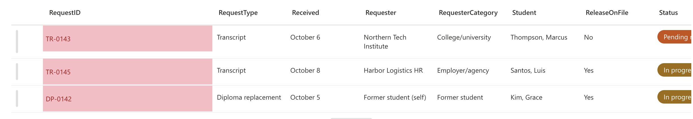

### How it was built

| 1. Site created | 2. Importing the data |
| --- | --- |
| 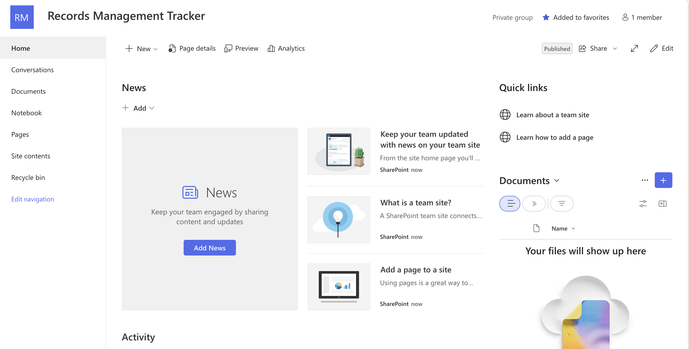 | 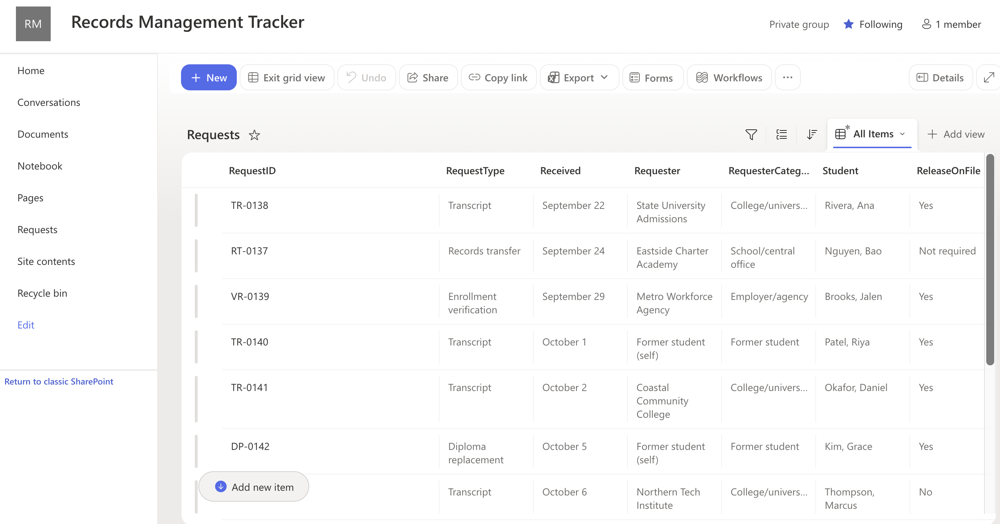 |
| **3. Requests list** | **4. Status choices** |
| 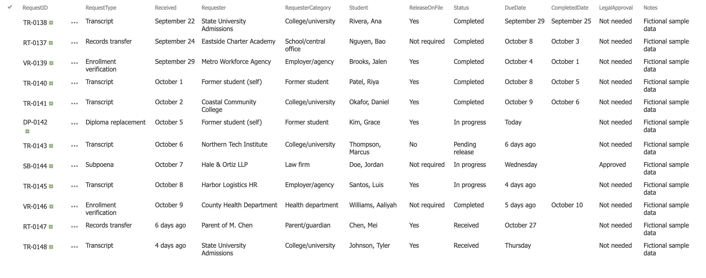 | 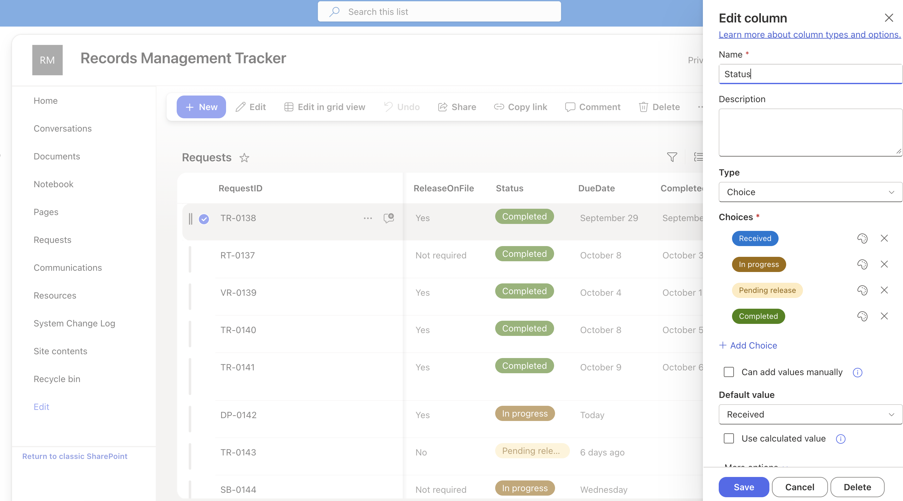 |
| **5. Completed in green, overdue in red** | **6. Request setup flow** |
| 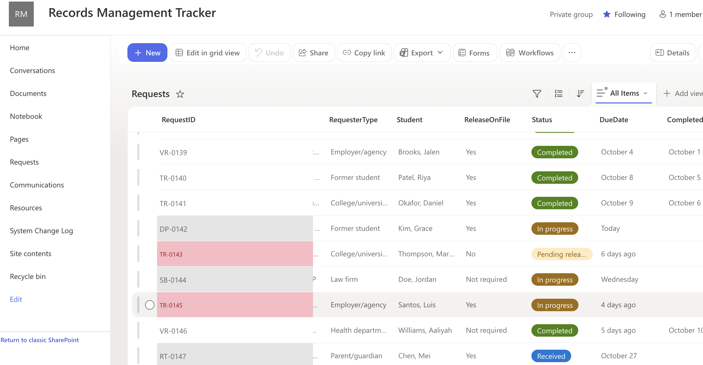 | 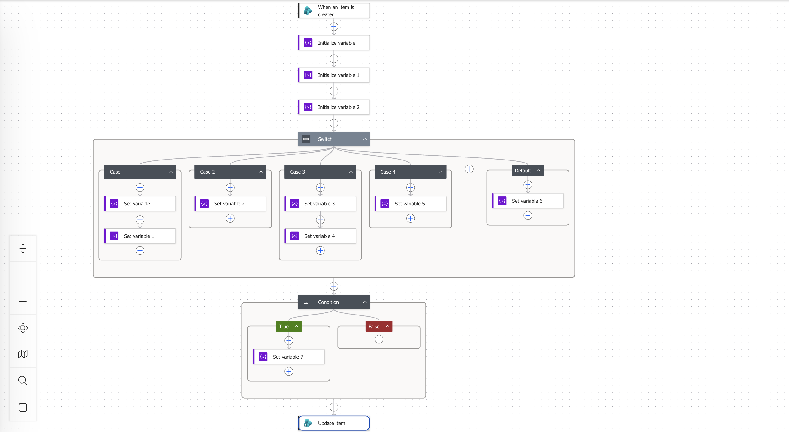 |
| **7. Successful run** | **8. ID and due date filled in automatically** |
| 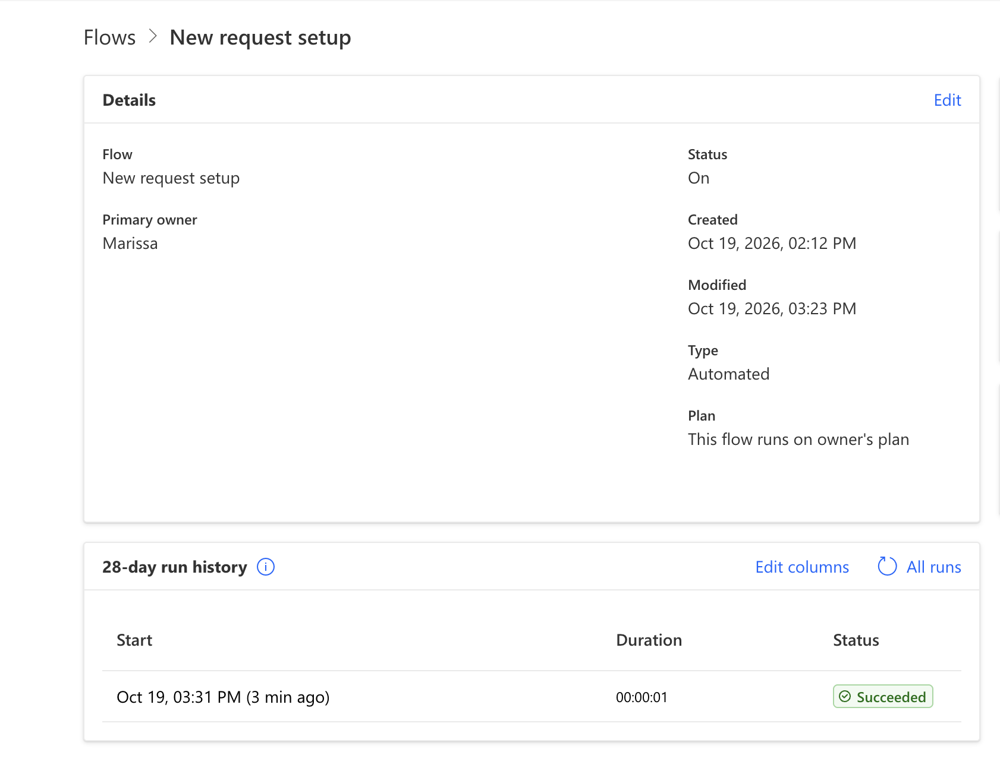 | 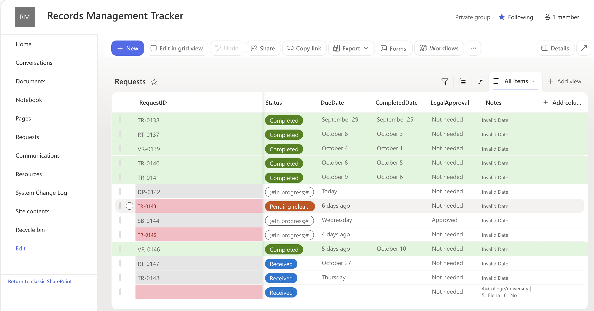 |
| **9. Subpoena sent to Legal for approval** | **10. Daily overdue report logged** |
| 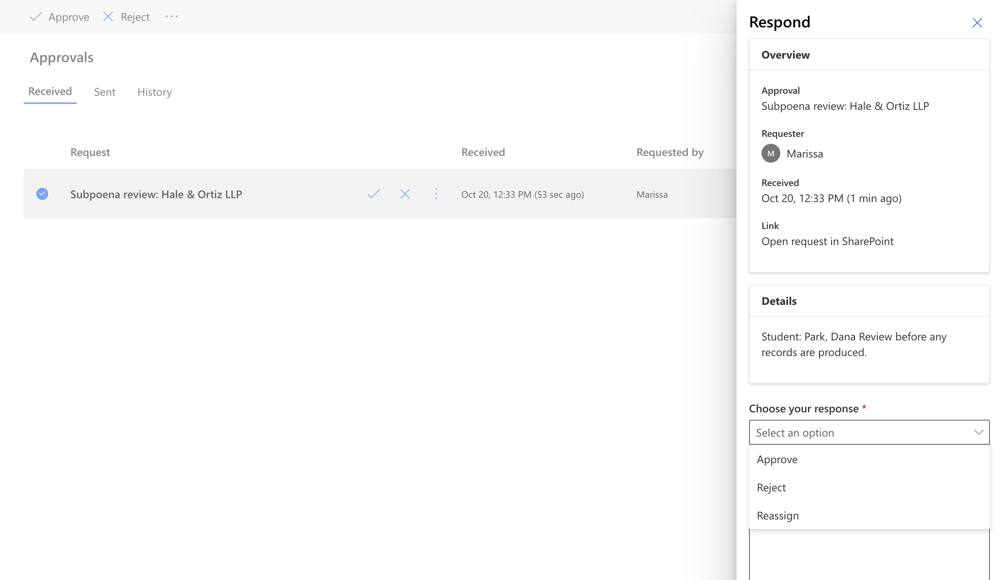 | 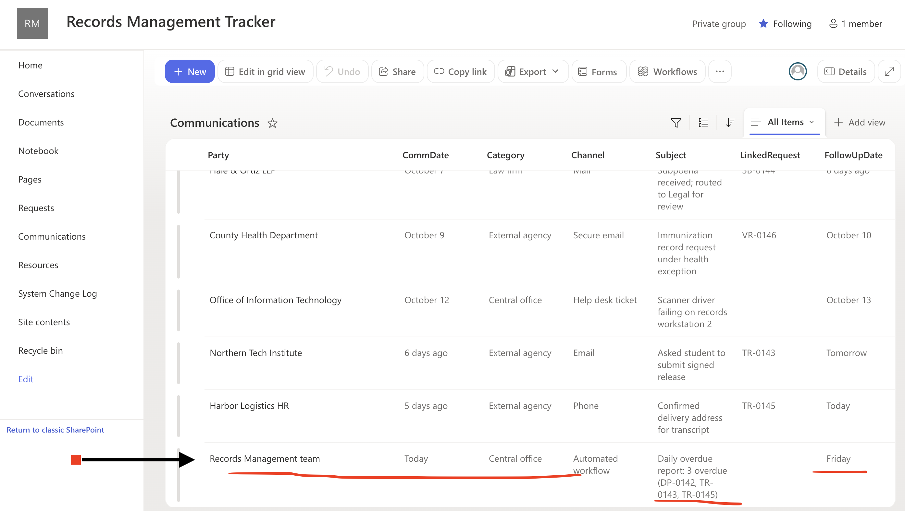 |
| **11. Dashboard: overdue requests** | **12. Dashboard: communications follow-ups** |
|  | 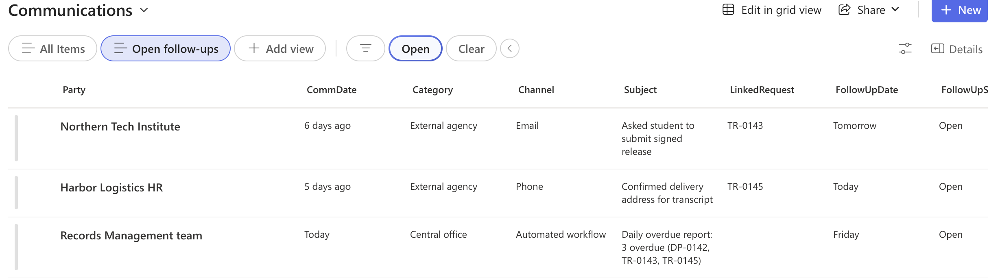 |
| **13. Dashboard: equipment due back** | **14. System change log** |
| 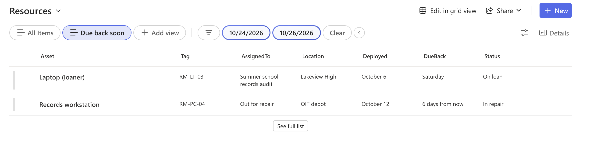 | 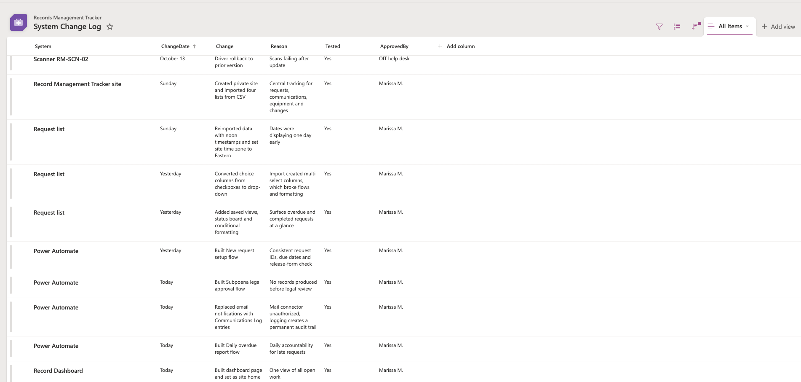 |

## Design decisions

- **Clean internal column names** (`RequestType`, `DueDate`) so flows and formatting never break when display names change.
- **Policy enforced by automation**, not memory: no release without consent, no subpoena production without legal review.
- **Flows never write the same field**, so they can run at the same time without overwriting each other.
- **Fictional data only**, so the whole system can be shown publicly.

## About me

I combine law enforcement records experience, as a sheriff's deputy in detention center booking and on patrol, with cloud systems administration, data platform engineering and PKI training. I built this project to show how records offices can be both careful and technically sound.

Marissa M · [LinkedIn] · [email]
